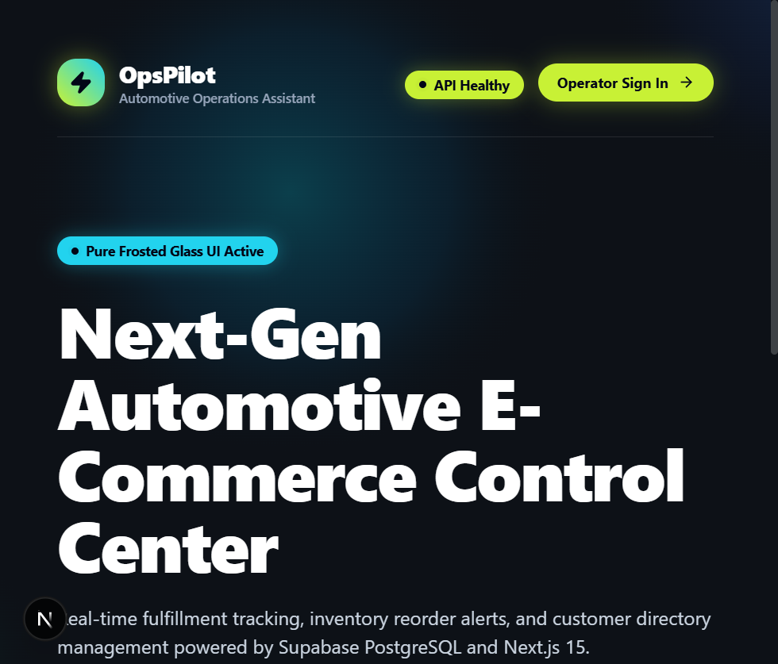
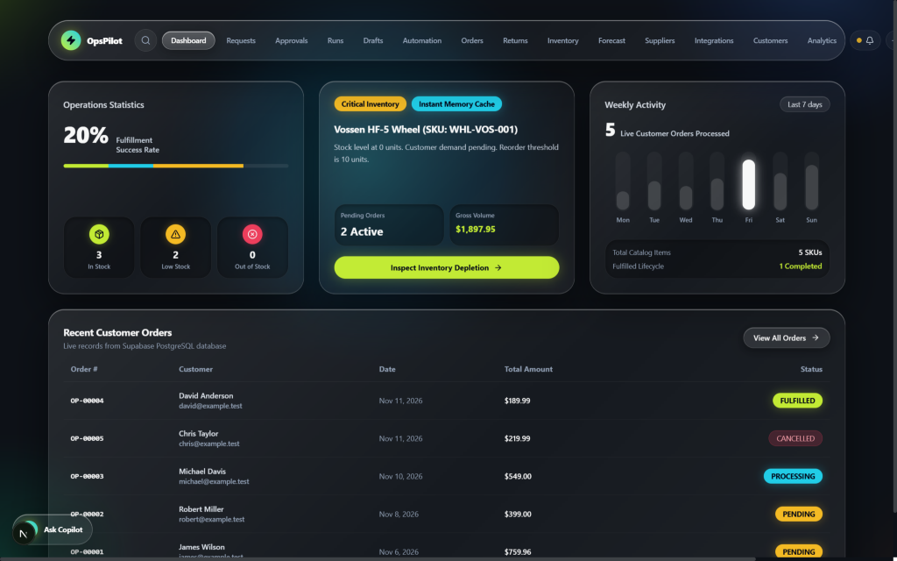
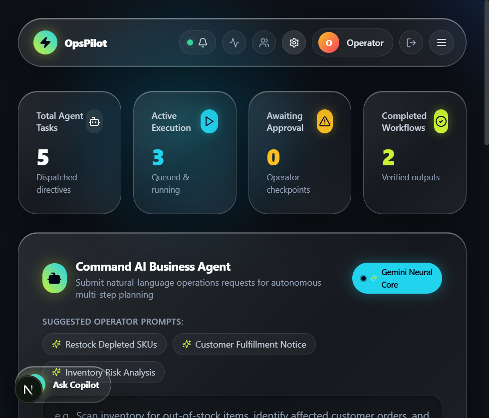
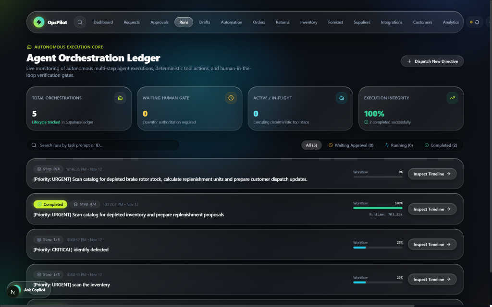
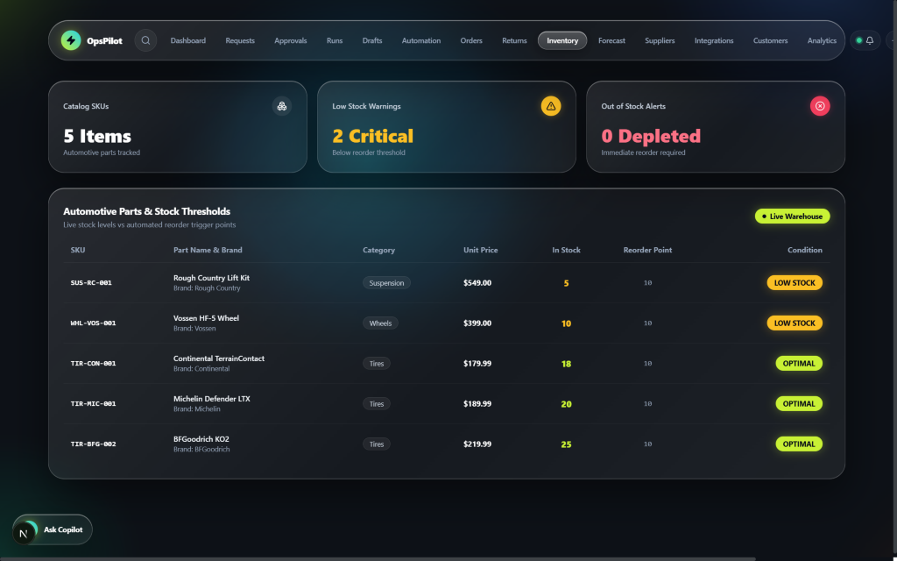
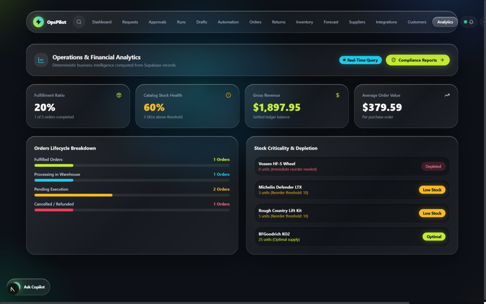

# OpsPilot (`Ops_pilot`)

> Autonomous AI Business Operations Platform for Automotive Logistics, Inventory Depletion & Customer Fulfillment.

OpsPilot is an enterprise-grade autonomous operations control center featuring a frosted glassmorphic UI, deterministic multi-step tool execution, human-in-the-loop approval gates, and Google Gemini neural planning backed by Supabase PostgreSQL.

---

## 📸 Product Screenshots

### Landing Page & Operator Portal (`/`)


### Operations Control Center (`/dashboard`)


### Natural-Language AI Intake (`/requests`)


### Agent Orchestration Ledger (`/runs`)


### Inventory & Stock Threshold Control (`/inventory`)


### Operations & Financial Analytics (`/analytics`)


---

## ✨ Key Features & Modules

### 🤖 Autonomous AI Orchestration
- **Natural-Language Business Intake (`/requests`)**: Submit arbitrary operations directives with priority levels (`normal`, `urgent`, `critical`) decomposed by Google Gemini into deterministic multi-step workflows.
- **Human-in-the-Loop Approval Gate (`/approvals`)**: Sensitive replenishment orders and external customer communications pause at operator authorization checkpoints.
- **Agent Orchestration Ledger (`/runs` & `/runs/[id]`)**: Live monitoring of autonomous runs, step-by-step execution timelines, tool inputs/outputs, and runtime telemetry.
- **Customer Communications & Drafts Hub (`/drafts`)**: Staging desk for agent-prepared fulfillment emails with inline refinement and dispatch.
- **Scheduled Automation (`/automation`)**: Recurring operational schedules and automated workflow triggers.
- **Floating AI Copilot (`/api/copilot`)**: Context-aware "Ask Copilot" assistant accessible across the dashboard.

### 📦 Supply Chain, Fulfillment & Catalog
- **Operations Overview (`/dashboard`)**: Real-time fulfillment success rate, critical inventory depletion alerts, weekly order throughput, and recent Supabase order records.
- **Orders & Returns (`/orders`, `/returns`)**: Purchase order lifecycle tracking (`PENDING`, `PROCESSING`, `FULFILLED`, `CANCELLED`) and RMA / returns processing.
- **Inventory & Demand Forecasting (`/inventory`, `/forecast`)**: Live SKU stock levels, reorder thresholds, and depletion forecasting.
- **Suppliers Hub (`/suppliers`)**: Supplier directory and replenishment coordination.
- **Customer Directory (`/customers`)**: Automotive client profiles, contact records, and order histories.

### 📊 Intelligence, Governance & Platform
- **Operations & Compliance Analytics (`/analytics`, `/analytics/reports`)**: Deterministic business intelligence (fulfillment ratio, stock health, gross revenue, AOV) and exportable compliance reports.
- **Integrations Hub (`/integrations`)**: External service connectors and webhook/API integrations.
- **Team RBAC, System Health & Settings (`/team`, `/system`, `/settings`, `/api/health`)**: Role-based access control, incident & telemetry monitoring, operator preferences, and health endpoint.

---

## 🛠️ Tech Stack

- **Framework**: [Next.js 15](https://nextjs.org/) (App Router, Server Components, Server Actions, Turbopack)
- **UI & Styling**: [React 19](https://react.dev/), [Tailwind CSS](https://tailwindcss.com/), [Lucide React](https://lucide.dev/)
- **Database & Auth**: [Supabase](https://supabase.com/) (PostgreSQL, Row Level Security, `@supabase/ssr` cookie-based auth)
- **AI Engine**: [Google Gemini](https://ai.google.dev/) via `@google/genai`
- **Validation & Language**: [TypeScript 5](https://www.typescriptlang.org/), [Zod](https://zod.dev/)

---

## 🚀 Getting Started

### 1. Clone the repository
```bash
git clone https://github.com/MUHAMMADHAMZAQAMAR/Ops_pilot.git
cd Ops_pilot
```

### 2. Install dependencies
```bash
npm install
```

### 3. Configure environment variables
Copy `.env.example` to `.env.local` and fill in your credentials:
```bash
cp .env.example .env.local
```

```env
PORT=3000
NEXT_PUBLIC_PORT=3000
NEXT_PUBLIC_APP_URL=http://localhost:3000
NEXT_PUBLIC_SUPABASE_URL=https://your-project.supabase.co
NEXT_PUBLIC_SUPABASE_ANON_KEY=your-anon-publishable-key

# Server-side only (never expose in browser or NEXT_PUBLIC_* variables)
SUPABASE_SERVICE_ROLE_KEY=your-service-role-key
GEMINI_API_KEY=your-gemini-api-key

# Demo Operator Credentials & Configuration
NEXT_PUBLIC_DEMO_OPERATOR_EMAIL=operator@opspilot.com
NEXT_PUBLIC_DEMO_OPERATOR_PASSWORD=Operator12345!
NEXT_PUBLIC_DEFAULT_OPERATOR_NAME=Alex Henderson
```

### 4. Database setup
Run the SQL migrations in order inside your Supabase SQL Editor, followed by the seed script:
1. `supabase/migrations/001_initial_schema.sql`
2. `supabase/migrations/002_automation_schedules.sql`
3. `supabase/migrations/003_operator_settings.sql`
4. `supabase/migrations/004_team_rbac.sql`
5. `supabase/migrations/005_suppliers_hub.sql`
6. `supabase/migrations/006_integrations_hub.sql`
7. `supabase/migrations/007_system_health.sql`
8. `supabase/migrations/008_returns_rma.sql`
9. `supabase/seed.sql`

### 5. Start the development server
```bash
npm run dev
```
Open [http://localhost:3000](http://localhost:3000) in your browser and sign in via `/login`.

### Available Scripts
- `npm run dev` — Start the Next.js development server with Turbopack
- `npm run build` — Build the production application
- `npm run start` — Start the production server
- `npm run lint` — Run Next.js ESLint checks

---

## 📄 License
MIT
